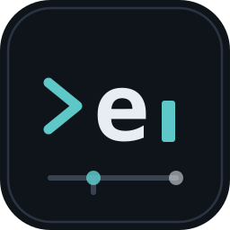

<p align="center">
  
</p>

<h1 align="center">Euler</h1>

<p align="center"><strong>A superset of Pi, tuned for vim-native terminal work.</strong></p>

<p align="center">
  <a href="docs/euler/README.md">Keys</a> ·
  <a href="docs/euler/CODE-REVIEW.md">Review &amp; next steps</a> ·
  <a href="docs/euler/PERFORMANCE.md">Performance</a> ·
  <a href="docs/euler/DOGFOOD.md">Dogfooding</a> ·
  <a href="docs/euler/CI.md">CI</a>
</p>

Euler is [Pi](https://github.com/earendil-works/pi) plus a modal, keyboard-first surface for
development work in a terminal. Everything Pi does, Euler still does — same tools, extensions,
skills, MCP servers, codemode, models and credentials — because it reads the same `~/.pi/agent`.

**What Euler adds over Pi**

| | |
|---|---|
| **Modal transcript** | normal/visual modes over rendered output: `hjkl`, `w/b/e`, `W/B/E`, `gg/G`, `H/M/L`, `{ }`, counts, `Ctrl-d/u/f/b`, `/` search |
| **Quotes** | select output and quote it: a persistent `custom_message` that becomes part of the conversation's context, with provenance |
| **Threads** | fork a session at any point into a new one that inherits the full branch (compaction included); a rail lists threads with parent lineage |
| **ADE surface** | persistent thread rail (`<space>e`) with `WORKING`/`IDLE` sections, density toggle (`v`), new thread (`<space>n`), external editor handoff (`:e`, `ctrl+g`), `@file` mentions, thread search |
| **Model & limits** | `:model` opens Pi's picker from normal mode; the statusline carries the active model and thinking level plus the most-consumed plan window |
| **Plan usage** | `:usage` reads subscription windows in percent for Claude, Codex and OpenCode Go, with reset countdowns and 50%/80% bars |
| **Context** | `:context` shows tokens against the window, the compaction threshold and reserve, the last request's cache split, and session counts |
| **Statusline** | brand bar + mode, thread name, live spinner, plan window, position, model — the chip and quota drop first when the line is tight |
| **Durable fork** | `tools/euler/upstream-gate.mjs` classifies upstream drift as safe / review / blocked before you merge a Pi release |
| **Dogfooding** | `euler --dev` / `npm run dev`: restart from source, queued until the current turn settles, so the agent can edit its own UI |

**Pi stays Pi.** `pi` is stock Pi; the modal layer only runs through the `euler` binary (or the
explicit `pi --ui euler` flag). No environment variable changes what `pi` is.

## Run it

```bash
npm install
npm run build
ln -s "$PWD/bin/euler" ~/.local/bin/euler
euler                       # bun when available, node otherwise
euler --dev                 # hot reload: source mode, restart on save, session resumed
euler --continue            # resume this directory's last session
npm run dev                 # the same supervisor without the launcher
```

Full guide: [docs/euler/README.md](docs/euler/README.md) — keys, quote/fork model, command line,
and the architecture seams that keep this fork mergeable.

---

## Upstream Pi

The rest of this file is Pi's own README, unchanged. Where it says "Pi", read "the harness Euler is
built on"; where it points at docs, those docs apply here too.

Pi is a minimal, extensible agent harness that you can make your own.

Adapt Pi to your workflows, not the other way around. Customize Pi with [extensions](packages/coding-agent/docs/extensions.md), [skills](packages/coding-agent/docs/skills.md), [prompt templates](packages/coding-agent/docs/prompt-templates.md), and [themes](packages/coding-agent/docs/themes.md). Bundle them as [Pi packages](packages/coding-agent/docs/packages.md) and share via npm or git.

Pi ships with powerful defaults but skips features like sub-agents and plan mode. Ask Pi to build what you want, or install a package that does it your way.

Use Pi [interactively](packages/coding-agent/docs/usage.md), automate it in [print or JSON mode](packages/coding-agent/docs/cli.md), control it over [RPC](packages/coding-agent/docs/rpc.md), or build apps with the [Pi TypeScript SDK](packages/coding-agent/docs/sdk.md). See [OpenClaw](https://github.com/OpenClaw/OpenClaw) for a real-world integration.

## Getting started

Install the command-line interface:

```bash
curl -fsSL https://pi.dev/install.sh | sh
```

On Windows:

```shell
powershell -c "irm https://pi.dev/install.ps1 | iex"
```

The installer pins all dependencies and updates Pi with `pi update`. Alternatively, install directly with npm, which does not pin transitive dependencies:

```bash
npm install -g --ignore-scripts @earendil-works/pi-coding-agent
```

Pi requires Node.js 22.19 or newer. The macOS, Linux, and Windows installers can install it if needed. Pi does not require dependency lifecycle scripts for a normal npm installation.

Start Pi in the directory where you want it to work:

```bash
cd /path/to/project
pi
```

For a built-in AI provider, run `/login` inside Pi to connect a subscription or API key. Then give Pi a task.

See the [documentation](https://pi.dev/docs/latest) for full setup and usage instructions, or [visit pi.dev](https://pi.dev) for demos.

## Run with Nix

```bash
nix run github:earendil-works/pi/stable
```

`stable` points at the latest release. Install it with `nix profile add github:earendil-works/pi/stable` and update with `nix profile upgrade pi`. Use a release tag such as `github:earendil-works/pi/v1.0.0` to pin a version, or `github:earendil-works/pi` for unreleased changes on `main`. Nix builds Pi from source.

Supports ARM64 and x86-64 on Linux and macOS. Use `nix build .` or `nix run .` to build or run your checkout.

Nix builds are offline, so the bundled model data comes from a pi.dev model catalog revision pinned in `nix/model-catalog.json`. At runtime, Pi still overlays newer catalog data from pi.dev as usual. The Nix workflow replaces the pin on `main` when it no longer matches the checkout, for example after a provider is added or gains a new model type. To refresh it by hand:

```bash
npm run update:model-catalog-pin
```

## Packages

This monorepo contains the Pi CLI and its supporting libraries.

| Package | Description |
|---------|-------------|
| **[@earendil-works/chord](packages/chord)** | Object runtime for apps across processes: contracts, documents, a store, links, plugins with hot reload, HTTP, workers, web and terminal clients |
| **[@earendil-works/pi-telemetry](packages/telemetry)** | Vendor-neutral telemetry contracts, reference adapter, conformance tests, and typed schemas |
| **[@earendil-works/pi-ai](packages/ai)** | Unified multi-provider LLM API (OpenAI, Anthropic, Google, etc.) |
| **[@earendil-works/pi-durable](packages/durable)** | Durable conversation, task, and document runtime |
| **[@earendil-works/pi-agent-core](packages/agent)** | Agent runtime with tool calling and state management |
| **[@earendil-works/pi-coding-agent](packages/coding-agent)** | Interactive coding agent CLI |
| **[@earendil-works/pi-tui](packages/tui)** | Terminal UI library with differential rendering |

For Slack/chat automation and workflows see [earendil-works/pi-chat](https://github.com/earendil-works/pi-chat).

## Permissions & Containerization

Pi does not include a built-in permission system for restricting filesystem, process, network, or credential access. By default, it runs with the permissions of the user and process that launched it.

If you need stronger boundaries, containerize or sandbox Pi. See [packages/coding-agent/docs/containerization.md](packages/coding-agent/docs/containerization.md) for three patterns:

- **Gondolin extension**: keep `pi` and provider auth on the host while routing built-in tools and `!` commands into a local Linux micro-VM.
- **Plain Docker**: run the whole `pi` process in a local container for simple isolation.
- **OpenShell**: run the whole `pi` process in a policy-controlled sandbox.

## Contributing

See [CONTRIBUTING.md](CONTRIBUTING.md) for contribution guidelines and [AGENTS.md](AGENTS.md) for project-specific rules (for both humans and agents).  Longer term plans for Pi can also be found in [RFCs](https://rfc.earendil.com/keyword/pi).

## Development

```bash
npm install --ignore-scripts  # Install all dependencies without running lifecycle scripts
npm run build         # Refresh model data, then build all packages
npm run build:offline # Rebuild using existing model data without network access
npm run check         # Lint, format, and type check
./test.sh            # Run tests (skips LLM-dependent tests without API keys)
./pi-test.sh         # Run pi from sources (can be run from any directory)
```

### Using local packages outside the monorepo

Build every public package into one coherent local artifact set:

```bash
npm run pack:packages -- --out .artifacts/pi-packages
```

This refreshes model data before building `pi-ai`. To avoid network access when
model data is already hydrated, pass `--offline-model-data`.

Then configure an external project to consume one package and resolve all of
its Pi dependencies from the same artifact set. npm is the default:

```bash
node scripts/use-local-packages.mjs \
  --manifest .artifacts/pi-packages/manifest.json \
  --consumer ../my-project \
  --package @earendil-works/pi-durable \
  --package @earendil-works/pi-agent-core
cd ../my-project
npm install --ignore-scripts
```

For a pnpm project, point `--consumer` at the workspace root:

```bash
node scripts/use-local-packages.mjs \
  --manifest .artifacts/pi-packages/manifest.json \
  --consumer ../my-project \
  --package @earendil-works/pi-agent-core \
  --package-manager pnpm
cd ../my-project
pnpm install --ignore-scripts
```

Repeat `--package` for each direct dependency. The command updates the
consumer's `package.json` with content-addressed local `file:` references. It
writes transitive overrides to `package.json` for npm or `pnpm-workspace.yaml`
for pnpm. Keep the artifact directory available while installing or updating
the consumer. Re-run both commands after changing Pi source.

## Building standalone binaries from release source

GitHub releases include a versioned source archive covered by the release's `SHA256SUMS` file. Extract it and run the same build script used for the official standalone binaries:

```bash
VERSION="<release-version>"
tar -xzf "pi-${VERSION}-source.tar.gz"
cd "pi-${VERSION}"
./scripts/build-binaries.sh --offline-model-data --platform linux-x64 --out "$PWD/out"
```

The archive includes release model data and native prebuilds. `--offline-model-data` uses that model data without refreshing provider catalogs. The script installs dependencies and builds the executable with its runtime assets; pass `--skip-install` if dependencies are already provided.

## Supply-chain hardening

We treat npm dependency changes as reviewed code changes.

- Direct external dependencies are pinned to exact versions. Internal workspace packages remain version-ranged.
- `.npmrc` sets `save-exact=true` and `min-release-age=2` to avoid same-day dependency releases during npm resolution.
- `package-lock.json` is the dependency ground truth. Pre-commit blocks accidental lockfile commits unless `PI_ALLOW_LOCKFILE_CHANGE=1` is set.
- `npm run check` verifies pinned direct deps, native TypeScript import compatibility, and the generated coding-agent install lock.
- The pi.dev installer installs from `packages/coding-agent/install-lock/`, generated from the root lockfile, to pin transitive deps. The npm package does not pin transitive deps.
- Local release smoke tests and npm publication use the same tarball packer; npm publishes the validated tarballs rather than repacking workspace directories.
- Local release installs, documented npm installs, and `pi update --self` use `--ignore-scripts` where supported.
- CI installs with `npm ci --ignore-scripts`, and a scheduled GitHub workflow runs `npm audit --omit=dev` plus `npm audit signatures --omit=dev`.
- Install lock generation has an explicit allowlist for dependency lifecycle scripts; new lifecycle-script deps fail checks until reviewed.

## Share your OSS coding agent sessions

If you use Pi or other coding agents for open source work, please share your sessions.

Public OSS session data helps improve coding agents with real-world tasks, tool use, failures, and fixes instead of toy benchmarks.

For the full explanation, see [this post on X](https://x.com/badlogicgames/status/2037811643774652911).

To publish sessions, use [`badlogic/pi-share-hf`](https://github.com/badlogic/pi-share-hf). Read its README.md for setup instructions. All you need is a Hugging Face account, the Hugging Face CLI, and `pi-share-hf`.

You can also watch [this video](https://x.com/badlogicgames/status/2041151967695634619), where I show how I publish my `pi-mono` sessions.

I regularly publish my own `pi-mono` work sessions here:

- [badlogicgames/pi-mono on Hugging Face](https://huggingface.co/datasets/badlogicgames/pi-mono)

## License

MIT

<p align="center">
  <a href="https://pi.dev">pi.dev</a> domain graciously donated by
  <br /><br />
  <a href="https://exe.dev"><br />exe.dev</a>
</p>
